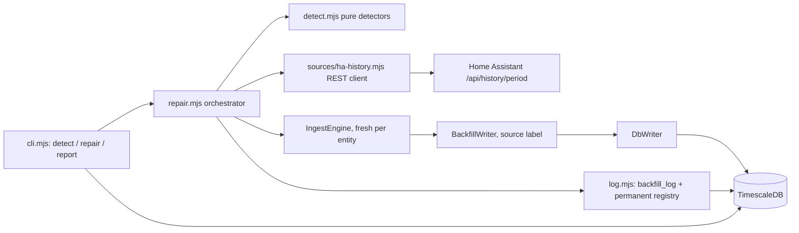

# Backfill mechanism design

Design of the generic backfill mechanism for the ingest package: detection of
gaps in the stored facts and repair by replaying Home Assistant recorder
history through the same sampling and delta logic that the live worker uses.
This document is the source of truth for the schema of `backfill_log`
(deploy/migrations/003_backfill_log.sql implements the schema block in
section 8 verbatim) and for the behaviour of the modules under
`ingest/src/backfill/`.

## 1. Problem

The ingest worker samples Home Assistant state changes into 5-minute buckets
and writes measurement samples, energy deltas, hourly prices and the daily
gas price. When the worker is down (restart, crash, network outage, server
maintenance), the worker itself writes nothing: those intervals are simply
missing from the database. The Home Assistant recorder, however, keeps the
raw state history and can serve it over the REST history API. The backfill
mechanism detects the missing intervals in the database, fetches the
recorded states for exactly those intervals, and writes the missing facts
again, without ever touching rows that already exist.

## 2. Design decisions

1. **Replay, no reimplementation.** `ingest/src/engine.mjs` is the single
   owner of the sampling and delta semantics: 5-minute buckets, counter delta
   derivation with a meter reset to 0, the baseline rule (the first bucket
   after a start writes no delta), and idempotent writes. The backfill
   repair does NOT contain any bucket or delta logic of its own. It replays
   the fetched states through a fresh `IngestEngine` instance with an
   injected writer, per entity, so a repaired gap is byte-for-byte what the
   live worker would have written.
2. **Additive labelling.** `energy_delta`, `price` and `gas_price` have a
   `source` column. Rows written by the HA history plugin are labelled
   `backfill-ha-history`; rows written by the Zonneplan price and gas price
   plugins are labelled `zonneplan-backfill`. The labelling is additive:
   `DbWriter` gained an optional `source` parameter (default `ingest`) on
   `writeEnergyDelta`, so worker behaviour is unchanged. The `measurement`
   table has no `source` column; backfilled samples are therefore
   indistinguishable from live ones in that table (still conflict-protected,
   never overwriting).
3. **Never overwrite.** All repaired facts are written with
   ON CONFLICT DO NOTHING. An existing row always wins; a repair run can
   only add rows, never change them. The existing row's `source` label is
   therefore also never rewritten by a backfill.
4. **Never redistribute catch-up deltas.** The engine's baseline rule keeps
   its meaning during replay: the bucket before a repaired range is the
   baseline, its delta is not written (it already exists), and the first
   repaired bucket derives its delta from the reading before the gap. No
   energy is ever shifted across bucket boundaries to "make totals fit".
5. **Cadence-aware detection.** A missing interval is only a gap when the
   entity's own observed cadence says data should have been there. Entity
   silence and slow cadences (a PV counter reporting every 15 minutes, an
   outdoor temperature sensor reporting hourly) produce zero repairable
   gaps. Section 6 has the exact rules.
6. **Bounded blast radius.** A repair run processes at most
   EMS_BACKFILL_MAX_ROWS_PER_RUN replayed states (default 5000) across the
   whole run; the run stops mid-way with outcome `partial` and continues on
   the next run. Detection windows are bounded by
   EMS_BACKFILL_LOOKBACK_DAYS (default 7 days).
7. **No-data corroboration.** An empty history fetch does not by itself mean
   anything: the entity may have been silent (nothing to repair), or the
   recorder may have been down or have purged the range (source problem).
   The repair corroborates: if other configured entities have states in the
   same range, the recorder was up and the entity was silent (outcome
   `no-gap`, nothing written); if no configured entity has states there,
   the recorder was down (outcome `source-down`, retried on the next run).
   With only one configured entity corroboration is impossible; the run then
   reports `source-down` (conservative: retry) rather than inventing
   confidence.
8. **Permanent ranges.** Source-down is never permanent: a source that is
   merely down is a retry case, not an unrecoverable one, and every run
   retries it naturally. The retry cost is bounded by design: the lookback
   window (default 7 days) bounds how long any range is re-scanned, and the
   per-run row cap bounds the hourly work. Permanent registration happens
   only when a source is confirmed unable to cover a range: uncovered price
   hours and gas days older than the recorder retention window
   (EMS_BACKFILL_RECORDER_RETENTION_DAYS, default 40, matching the
   recorder's purge_keep_days), registered only when the fallback history
   source was consulted and answered (a fetch error confirms nothing). A gap
   range covered by a row previously marked permanent in `backfill_log`
   (outcome `permanent`) is excluded by detection for price, gas_price and
   bucket kinds (`permanentRanges` overlap lookups; a bucket gap is skipped
   when a permanent range fully contains it). The sample/counter path never
   writes permanent rows; the price and gas paths register them only under
   the confirmed-unable rule above.
9. **Worker untouched.** The running worker (src/index.mjs) is not modified
   and does not import the backfill modules. The backfill runs as a CLI
   command (detect, repair, report), manually or from a timer/unit that a
   later phase adds.
10. **No new dependencies.** The mechanism uses the global `fetch` for the
    HA REST API and the existing `pg` for the database. Secrets come from the
    existing ingest/.env (HA_WS_URL, HA_TOKEN, PG*); the HTTP base is
    derived from HA_WS_URL (ws:// to http://, wss:// to https://). No new
    env files.

## 3. Outcome taxonomy

Every repair run writes exactly one `backfill_log` row per processed entity
and kind, with one of six outcomes. Exit code of the CLI is 0 for all of
them; they describe data, not program failure.

| Outcome | Meaning |
|---|---|
| `repaired` | At least one repairable gap existed and was fully handled this run: rows were written (and/or some gaps turned out to be corroborated silence). Existing rows were untouched. |
| `partial` | The run stopped mid-way: the row budget was exhausted, or some gaps were repaired while others returned no data (source-down). The unhandled gaps are retried on the next run. |
| `source-down` | The history fetch failed (typed error, Home Assistant unreachable) or returned no states while corroboration says the recorder was down. Retried on the next run. |
| `permanent` | All repairable gaps are inside ranges previously marked permanent; nothing was attempted. |
| `no-gap` | Nothing to repair: no repairable gaps detected (silence and slow cadence are not gaps), or every gap was corroborated entity silence (other entities do have states in the range). |
| `attribution-suspect` | Report only, written by the class 2 catch-up detection of a later block: a gap whose energy cannot be attributed to buckets. No rows are written for it. |

## 4. Architecture



The orchestrator is dependency-injected end to end: row loader, history
fetch, writer and log store are parameters of `runBackfill`. The CLI wires
them to `pg` and the HA REST API; the verification script
(ingest/scripts/verify-backfill.mjs) wires them to in-memory fakes, which is
how the mechanism is verified without touching a production database.

## 5. Module map

| File | Contents |
|---|---|
| ingest/src/backfill/detect.mjs | pure gap detectors: `detectPriceGaps`, `detectGasPriceGaps`, `detectBucketGaps`, `medianIntervalBuckets`. No I/O. |
| ingest/src/backfill/sources/ha-history.mjs | HA REST history client (`fetchEntityHistory`) and `haHttpBaseFromWsUrl`. Fail-soft: returns a typed `{error}` object, never throws past the plugin boundary. |
| ingest/src/backfill/sources/price-forecast.mjs | Zonneplan tariff forecast (`fetchPriceForecast`, `parseForecastHours`): 15-minute blocks averaged into hours, 1e-7 EUR/kWh converted to EUR. Only hours the attribute covers are provided. |
| ingest/src/backfill/sources/price-history.mjs | price fallback (`fetchTariffHistory`, `hourlyPricesFromStates`): recorder history of the tariff entity, last observation per hour wins. |
| ingest/src/backfill/sources/gas-price-history.mjs | gas price source (`fetchGasPriceHistory`, `dailyPricesFromStates`, `localDayStartMs`): recorder history of the configured gas price entity, first observation per local day wins. |
| ingest/src/backfill/repair.mjs | orchestrator `runBackfill` plus the SQL loaders (rows, price hours, gas days). Replay, corroboration, budget, price/gas repair, permanent registration, outcomes. |
| ingest/src/backfill/writer.mjs | `BackfillWriter`: engine-writer adapter that labels writes with the backfill source and tracks pending inserts. |
| ingest/src/backfill/log.mjs | `createBackfillLog`: backfill_log inserts, permanent-range registry (mark permanent, is-permanent, permanent ranges), recent rows. |
| ingest/src/backfill/cli.mjs | commands detect, repair (default), report; flags --kind, --entity, --since, --dry-run, --auto, --limit. |
| ingest/src/db.mjs | DbWriter with the additive `source` parameter (default `ingest`); write methods return their insert count. |
| ingest/scripts/verify-backfill.mjs | manual verification script with fake writer, fake fetch and fake log (no database, no Home Assistant). |
| ingest/test/backfill-detect.test.mjs | unit tests of the pure detectors (node:test). |
| deploy/ems-backfill.service + .timer | oneshot service and hourly timer for the automated repair run. |
| deploy/migrations/003_backfill_log.sql | idempotent migration creating `backfill_log`. |

## 6. Gap detection rules

All detectors are pure functions of the existing rows and the window; the
clock is injectable through the window bounds. The grid is the same UTC grid
the worker stores on: 5-minute buckets, hours, and local calendar days for
gas prices.

**Prices** (`detectPriceGaps(existingHours, fromMs, toMs)`): the expected
hours are the hourly grid from hourOf(fromMs) up to (excluding) hourOf(toMs);
a run of consecutive missing hours is one gap. DST transitions do not
disturb the grid: prices are stored on UTC hours, and the Amsterdam offset is
always a whole number of hours, so every local hour is one UTC hour (at
fall-back the repeated local hour is two distinct UTC hours).

**Gas prices** (`detectGasPriceGaps(existingDays, fromDate, toDate)`): the
expected days are the local-day strings from fromDate to toDate inclusive;
returns the missing day strings.

**Samples and counters** (`detectBucketGaps(rows, fromMs, toMs, opts)`),
cadence-aware:

1. Take the entity's rows (bucket starts) inside the window.
2. The entity's cadence is `medianIntervalBuckets`: the median interval
   between consecutive rows, in 5-minute buckets, minimum 1.
3. A missing run between two consecutive rows with span L buckets
   (L = right row minus left row, in buckets) counts as a gap only when
   L > 3 x median AND L >= 6 (absolute minimum: 6 buckets). The span, not
   the missing-bucket count, is compared, so the rule reads "the interval
   between two neighbours is more than three times the normal interval".
4. A gap is repairable only when L <= opts.maxGapBuckets (default 36, three
   hours). Longer bounded runs are reportable but not repairable: the blast
   radius of one repair is capped.
5. A gap is repairable only when bounded on BOTH sides by existing rows.
   Unbounded runs (no later row, for example entity silence up to now) are
   never repairable, only reportable, and only when they exceed the cadence
   threshold from rule 3. A run with no earlier row (the window starts
   inside the silence) is ignored entirely: without a left bound it cannot
   be distinguished from "not ingested yet".
6. Consequences pinned by tests: a PV counter at 15-minute spacing and a
   weather sensor at 1-hour spacing produce zero repairable gaps, entity
   silence produces zero repairable gaps, and a 45-minute outage in a
   5-minute-cadence stream is a gap (span 9 buckets > 6).

Return shape: `{ medianIntervalBuckets, repairable: [{startMs, endMs,
spanBuckets, missingBuckets}], reportable: [{..., reason: "too-long" |
"unbounded"}] }`, where startMs is the first missing bucket and endMs is
the first existing bucket after the run (for unbounded runs, the window end).

## 7. Repair replay

For each configured entity of kind `sample` or `counter`:

1. Load the existing rows from the window (measurement for samples,
   energy_delta for counters) and run `detectBucketGaps`.
2. Drop gaps fully inside permanent ranges. Source-down is never permanent:
   a source-down outcome writes its log row and moves on; the next run
   retries the gap naturally (nothing here counts attempts).
3. For each remaining gap, fetch the HA history for
   [startMs - 1 bucket, endMs + 1 bucket). The one bucket of left padding
   gives the engine the reading before the gap (the baseline rule then
   reproduces the delta of the first missing bucket exactly as the worker
   would have); the right padding gives a state after the last missing
   bucket so the engine finalizes it.
4. Replay the fetched states (ascending, `last_updated_ts` as timestamp)
   through a fresh IngestEngine, one per entity, registered with only that
   entity's configuration, writing via `BackfillWriter` around `DbWriter`
   with source `backfill-ha-history`. A final `tick()` with the clock at
   the gap end closes the last bucket. Writes land on the same unique
   indexes as live writes: ON CONFLICT DO NOTHING.
5. Replay restores exactly what the recorder saw: buckets in which the
   sensor was silent get no row (the engine never invents rows), and the
   bucket before the gap is written not at all (baseline, and its row
   already exists). Non-numeric states are ignored by the engine, as live.
6. Empty fetch (or only non-numeric states): corroborate against the other
   configured entities over the gap range (section 2, rule 7).
7. Aggregate the per-gap results into the per-entity outcome (section 3),
   flush the writer, and insert one backfill_log row with the outcome, the
   union range of the entity's gaps (or the window when there were none),
   the run provenance (run_kind, source) and honest bookkeeping:
   rows_written (rows actually inserted) next to rows_missing (detected
   missing buckets this run did not write: not-attempted or truncated gaps,
   corroborated-silence buckets, source-down gaps; 0 on a fully repaired
   gap), plus a structured detail (JSONB) with a human-readable summary
   field and the counters.

`--dry-run` performs detection and the history fetches but performs no
writes at all: no replay, no backfill_log inserts, no permanent marking.

### 7.1 Price and gas price repair

Prices (kind `price`): `detectPriceGaps` over the price table (tariff
`normaal`) within the lookback window, minus the hours fully covered by
permanent ranges. Every missing hour is repaired from two sources in order:

1. The Zonneplan tariff forecast (plugin `zonneplan-forecast`): the entity
   sensor.zonneplan_current_quarter_hourly_electricity_tariff carries a
   rolling forecast attribute with 15-minute blocks; the blocks of an hour
   are averaged (up to 4) and the amount is converted from 1e-7 EUR/kWh to
   EUR/kWh. Only hours the attribute actually covers are provided; hours
   before the rolling window start fall through to the fallback.
2. The recorder history of the tariff entity (plugin `zonneplan-history`):
   every state observation is mapped to the start of its hour and the last
   observation before the hour boundary wins, matching the engine's
   writePrice-on-change upsert semantics.

A source that yields nothing for an hour does not fail the run. Rows are
written with tariff `normaal` and source `zonneplan-backfill` (the same
writePrice shape as the live path, additive source), only for hours detected
missing, so no existing row is ever touched. Hours no source covers are
retried while they are recent (outcome `partial`); once older than the
recorder retention window they are registered permanent (outcome
`permanent`), but only when the fallback source was consulted and answered.

Gas prices (kind `gas_price`): `detectGasPriceGaps` over the gas_price
table, minus the days fully covered by permanent ranges. The recorder
history of the configured gas price entity (entity id from config.json, not
hardcoded twice) is fetched for the missing-day range; every state
observation is a candidate for the LOCAL day (Europe/Amsterdam, the same
dayOf semantics as the engine) it was observed in, and the first observation
per local day wins, so an evening pre-publication of the next day's price
never leaks into the current day. Uncovered days follow the same
retry-then-permanent rule as the price hours.

Both paths record their provenance per run: `run_kind` (auto for the hourly
timer, cli for manual runs) and `source` (the plugin that supplied the
rows; `zonneplan-forecast` when the forecast supplied at least as many hours
as the fallback, otherwise `zonneplan-history`; `zonneplan-history` for the
gas path). The structured detail carries the exact per-plugin counters.

### 7.2 Automation

deploy/ems-backfill.timer starts deploy/ems-backfill.service hourly
(RandomizedDelaySec 300, Persistent true). The service is a oneshot that
runs `cli.mjs repair --auto`: run_kind `auto`, a journal-friendly one-line
summary per entity, and exit 0 for every data outcome (source-down is
retried by the next hourly run). See deploy/README.md for installation.

## 8. Schema

`backfill_log` is a plain table (not a hypertable): one row per entity and
kind per run, small volume, kept forever as the audit trail of what was
repaired and what was given up. `ha_entity_id` is stored as text because
price and gas_price entities have no row in the entity dimension table.
Provenance is part of every row: `run_kind` distinguishes timer runs
(`auto`, a later build block) from manual CLI runs (`cli`), and `source`
records which plugin supplied the rows (`ha-history` today;
`zonneplan-forecast` and `zonneplan-history` arrive with the later plugins;
`none` for registry-only rows).

```sql
CREATE TABLE IF NOT EXISTS backfill_log (
    id            BIGSERIAL PRIMARY KEY,
    ha_entity_id  TEXT NOT NULL,           -- configured entity, also for kinds without an entity table row
    kind          TEXT NOT NULL,           -- sample | counter | price | gas_price
    run_kind      TEXT NOT NULL,           -- auto (timer) | cli (manual)
    source        TEXT NOT NULL,           -- ha-history | zonneplan-forecast | zonneplan-history | none
    outcome       TEXT NOT NULL CHECK (outcome IN ('repaired', 'partial', 'source-down', 'permanent', 'no-gap', 'attribution-suspect')),
    range_start   TIMESTAMPTZ NOT NULL,    -- union of the entity's repairable gaps this run (window when none)
    range_end     TIMESTAMPTZ NOT NULL,
    rows_written  INTEGER NOT NULL DEFAULT 0,
    rows_missing  INTEGER NOT NULL DEFAULT 0, -- detected missing buckets this run did not write
    detail        JSONB,                    -- structured audit: summary plus counters
    created_at    TIMESTAMPTZ NOT NULL DEFAULT now()
);

CREATE INDEX IF NOT EXISTS ix_backfill_log_entity ON backfill_log (ha_entity_id, kind, id DESC);
```

The migration deploy/migrations/003_backfill_log.sql contains exactly this
schema block (plus comments) and is idempotent, run with plain psql and no
transaction wrapper, in line with migrations 001 and 002. Note: init.sql
creates the base schema for fresh containers; run migration 003 once on
any database that predates it, including a fresh one (the migration is
safe to run repeatedly).

## 9. Honesty rules

These rules are invariant for every present and future backfill plugin:

1. Never overwrite an existing row: ON CONFLICT DO NOTHING only. Existing
   rows and their source labels are untouchable.
2. Never redistribute catch-up deltas: deltas derive only from neighbouring
   readings via the engine; no energy is moved across buckets.
3. Never invent rows: only what the recorder saw is replayed; silence stays
   silence.
4. Backfilled rows are labelled with their plugin source
   (`backfill-ha-history`, later `zonneplan-backfill`) wherever the table
   has a source column.
5. Silence is not data loss: cadence-aware detection and corroboration
   decide, and the conservative answer (source-down, retry) is preferred
   over declaring a repair that cannot be corroborated.
6. Every repair attempt is auditable: one backfill_log row per entity and
   kind per run, with the honest outcome and honest bookkeeping
   (rows_written next to rows_missing), even when nothing was written.
7. Bounded blast radius: capped rows per run, capped gap size per repair,
   capped lookback window; permanent ranges stop futile retries.
8. A repair run is read-only with respect to live ingestion: it never
   deletes, never updates, and writes only rows the live worker has not
   written (unique indexes decide, not the plugin).

## 10. Environment variables and CLI

Secrets and connection details come from the existing ingest/.env
(PG* are read by pg itself):

| Variable | Default | Meaning |
|---|---|---|
| HA_WS_URL | ws://localhost:8123/api/websocket | WebSocket endpoint; the HTTP base is derived from it (ws to http, wss to https) |
| HA_TOKEN | (required) | long-lived access token |
| EMS_TIMEZONE | Europe/Amsterdam | local time zone for daily facts |
| EMS_BACKFILL_LOOKBACK_DAYS | 7 | detection window in days (before now) |
| EMS_BACKFILL_MAX_ROWS_PER_RUN | 5000 | maximum replayed states per repair run |
| EMS_BACKFILL_MAX_GAP_BUCKETS | 36 | maximum span in buckets of a repairable gap |
| EMS_BACKFILL_RECORDER_RETENTION_DAYS | 40 | uncovered hours/days older than this window are registered permanent |

```bash
cd ingest

node src/backfill/cli.mjs detect                      # report only, no writes
node src/backfill/cli.mjs detect --kind price --since 2026-01-01T00:00:00Z
node src/backfill/cli.mjs repair                      # full run (default command)
node src/backfill/cli.mjs repair --entity sensor.grid_consumption_total
node src/backfill/cli.mjs repair --dry-run            # detect + fetch, no writes
node src/backfill/cli.mjs report --limit 50           # last N backfill_log rows

node scripts/verify-backfill.mjs                      # manual verification with fakes
```

Exit code 0 covers every data outcome including no-gap; non-zero is for
program errors (missing config.json or HA_TOKEN, unreachable database).
config.json is untracked deployment configuration (see config.example.json
for the shape); detect and repair refuse to start without it, report needs
no config.json, and the unit tests use fixtures instead of config.json.

## 11. Verification

`node --test test/` runs the unit suite, including the pure detector tests
(test/backfill-detect.test.mjs). The manual verification script
`node scripts/verify-backfill.mjs` builds a synthetic gap over a fake
writer, fetches a fake HA history, runs the real orchestrator and asserts:
exactly the missing buckets are filled, with the backfill source label;
existing ingest rows are untouched; the backfill_log rows carry the correct
outcomes (repaired, no-gap via corroboration, source-down, partial under a
row budget, and nothing written in dry-run). It needs no database and no
Home Assistant, so it can never touch production.
