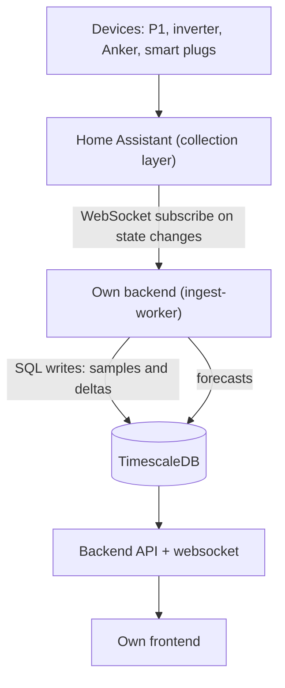

# Database phase: PostgreSQL/TimescaleDB

Design of the data layer for the home energy management system, matching the chosen architecture: devices, Home Assistant (collection layer), own backend, own frontend.

## 1. Key architecture decision

The Home Assistant recorder does not support PostgreSQL as a backend (only SQLite, MariaDB/MySQL). The database is therefore not fed through the recorder, but by the own backend, which subscribes to Home Assistant state changes via the WebSocket API and writes the sampled measurements to TimescaleDB. The recorder keeps running on the server as a buffer and presentation layer.

Subscribing over polling: with REST-API polling, every interval in which the backend is not running (restart, network outage) is lost. With a WebSocket subscription the worker receives every fact and samples it itself. Backfilling from the recorder database (states or long-term statistics) remains possible as a safety net for incidents.

Retention consequence: as long as the backend is not running yet, the recorder's default retention (roughly 10 days for states; long-term statistics considerably longer) limits how far back data can be recovered. To be safe, the recorder retention is temporarily raised to about 40 days (purge_keep_days: 40) so no gap occurs between this phase and the backend phase.



## 2. Containers

Extension of the existing Docker setup on the server (static LAN address, configured via EMS_DB_BIND_IP):

| Container | Image | Port | Description |
|---|---|---|---|
| timescaledb | timescale/timescaledb:latest-pg16 | 5432 (LAN only) | database with the Timescale extension |
| db-backup | prodrigestivill/postgres-backup-local | none | nightly pg_dump with retention |
| ingest-worker | own image (Node) | none | reads HA, writes to the database |
| adminer/pgadmin | optional | temporary | administration and inspection during development |

Important: never expose the database port to the internet; restrict access to the Docker network and the LAN.

## 3. Data model

Principle: measurement samples and energy deltas are stored as separate facts, plus a dimension table for entities and a separate table for dynamic tariffs. Aggregations (hour, day) are computed by TimescaleDB itself via continuous aggregates, so the dashboard gets fast queries without the backend having to aggregate.

### 3.1 Dimension: entities

```sql
CREATE TABLE entity (
    id            SMALLSERIAL PRIMARY KEY,
    ha_entity_id  TEXT NOT NULL UNIQUE,   -- e.g. sensor.p1_active_power
    name          TEXT NOT NULL,           -- e.g. "House grid consumption"
    domain        TEXT NOT NULL,           -- grid, pv, battery, plug, weather, price, heat
    device_class  TEXT,
    unit          TEXT,                    -- kW, kWh, W, EUR/kWh, %
    is_counter    BOOLEAN NOT NULL DEFAULT FALSE,  -- true for cumulative kWh meters (worker derives deltas)
    created_at    TIMESTAMPTZ NOT NULL DEFAULT now()
);
```

### 3.2 Facts: measurement samples and energy deltas (two hypertables)

Measurement samples (power, SOC, percentages) and energy are different facts: over power values an average is meaningful, over energy only a sum. Cumulative kWh meters do not produce sums but meter readings. The ingest worker therefore computes a delta in kWh per 5-minute interval and writes it to energy_delta; sum(delta_kwh) is then correct per hour, day and month. Meter resets (reading drops) are detected and yield delta 0.

All timestamps are rounded to the 5-minute bucket start, so the unique index (entity_id, ts) makes duplicates predictable and writes idempotent.

```sql
CREATE EXTENSION IF NOT EXISTS timescaledb;

CREATE TABLE measurement (          -- samples: kW, W, %, temperature
    entity_id  SMALLINT NOT NULL REFERENCES entity(id),
    ts         TIMESTAMPTZ NOT NULL,  -- bucket start (5 min)
    value      DOUBLE PRECISION NOT NULL,
    state      TEXT
);
SELECT create_hypertable('measurement', 'ts', chunk_time_interval => INTERVAL '1 day');
CREATE UNIQUE INDEX ux_measurement_entity_ts ON measurement (entity_id, ts DESC);

CREATE TABLE energy_delta (        -- energy per 5-minute interval
    entity_id  SMALLINT NOT NULL REFERENCES entity(id),
    ts         TIMESTAMPTZ NOT NULL,  -- bucket start (5 min)
    delta_kwh  DOUBLE PRECISION NOT NULL,
    source     TEXT NOT NULL DEFAULT 'ingest'
);
SELECT create_hypertable('energy_delta', 'ts', chunk_time_interval => INTERVAL '1 day');
CREATE UNIQUE INDEX ux_energy_delta_entity_ts ON energy_delta (entity_id, ts DESC);
```

### 3.3 Fact: dynamic hourly tariffs

```sql
CREATE TABLE price (
    ts        TIMESTAMPTZ NOT NULL,   -- hour start
    tariff    TEXT NOT NULL DEFAULT 'normaal',
    price_eur DOUBLE PRECISION NOT NULL,  -- EUR/kWh (incl. VAT and levies)
    source    TEXT NOT NULL DEFAULT 'zonneplan',
    PRIMARY KEY (ts, tariff)
);

SELECT create_hypertable('price', 'ts', chunk_time_interval => INTERVAL '1 month');
```

### 3.4 Continuous aggregates

Sums are computed exclusively over energy_delta; over measurement samples only average, maximum and minimum. The full SQL with all policies is in deploy/initdb/init.sql.

```sql
-- Power: hourly avg/max/min
CREATE MATERIALIZED VIEW measurement_hourly
WITH (timescaledb.continuous) AS
SELECT entity_id, time_bucket('1 hour', ts) AS bucket,
       avg(value) AS avg_value, max(value) AS max_value, min(value) AS min_value
FROM measurement
GROUP BY entity_id, bucket
WITH NO DATA;

-- Energy: hourly and daily sums over the deltas
CREATE MATERIALIZED VIEW energy_hourly
WITH (timescaledb.continuous) AS
SELECT entity_id, time_bucket('1 hour', ts) AS bucket, sum(delta_kwh) AS kwh
FROM energy_delta
GROUP BY entity_id, bucket
WITH NO DATA;

CREATE MATERIALIZED VIEW energy_daily
WITH (timescaledb.continuous) AS
SELECT entity_id, time_bucket('1 day', ts) AS bucket, sum(delta_kwh) AS kwh
FROM energy_delta
GROUP BY entity_id, bucket
WITH NO DATA;
```

## 4. Entities to be ingested

| Source | Entities (domain) | Interval | Type |
|---|---|---|---|
| Zonneplan One (P1) | Grid consumption, grid feed-in (grid) | 5 min | kWh cumulative + kW |
| Zonneplan One | Inverter yield (pv) | 5 min | kWh cumulative |
| Zonneplan official | Current electricity price, sustainability score (price) | hourly | EUR/kWh |
| Anker SOLIX Max | Charge/discharge power, SOC (battery) | 5 min | kW, % |
| Anker smart plugs | Power and energy per appliance (plug) | 5 min (Modbus provides 5 s, sampled to 5 min) | W, kWh |
| Forecast.Solar | Production forecast (pv) | 1 hour | kWh forecast |
| Evohome (later) | Heat demand per zone (heat) | 15 min | % |
| Daikin (later) | Heat pump consumption (heat) | 5-15 min | kWh, temperature |

Sampling strategy: 5 minutes for everything is more than sufficient for savings analysis and forecasts, and keeps storage small. The smart plugs deliver 5-second updates, but only a 5-minute sample is stored; raw 5-second data remains available in the recorder.

## 5. Retention and backups

| Data | Retention |
|---|---|
| measurement and energy_delta (raw, 5 min) | 1 year, then drop policy (aggregates remain) |
| measurement_hourly and energy_hourly | 5 years |
| energy_daily | kept forever |
| price | kept forever (small, and needed for correct savings lookback) |

```sql
SELECT add_retention_policy('measurement', INTERVAL '1 year');
SELECT add_retention_policy('energy_delta', INTERVAL '1 year');
SELECT add_retention_policy('measurement_hourly', INTERVAL '5 years');
SELECT add_retention_policy('energy_hourly', INTERVAL '5 years');
```

Backup policy: the entire database lives on a single SSD in a single container; without a backup a disk failure is fatal for the whole energy history. The db-backup container runs a nightly pg_dump with retention of 14 daily and 8 weekly dumps, stored outside the database volume. Because energy_daily and price are kept forever, the history can be restored from any dump.

Storage estimate: roughly 25 entities x 288 samples per day x 365 days is about 2.6 million rows per year; with compression that is well under 1 GB per year.

## 6. Incorporated points of attention

- Recorder retention (roughly 10 days for states) is the weak spot; the solution is temporarily raising purge_keep_days and running the ingest worker early, so the first backend run can backfill up to about 40 days.
- Hourly tariffs arrive automatically from the Zonneplan integration; a price is never entered manually.
- Monthly entities of the official Zonneplan integration are delayed and are ignored for the database; only the direct meters and the hourly price entity are ingested.
- The database runs on the same server as Home Assistant; Docker network, no external access. Any external access via Tailscale then also applies to the database.

## 7. Database phase roadmap

1. Clone the repository on the server; deploy-db.sh runs the compose stack and the init script automatically.
2. Verify the schema (the script prints tables, views and hypertables).
3. Check what the recorder database actually contains: states (roughly 10 days by default) and long-term statistics (longer). Decide whether purge_keep_days is temporarily raised to 40 days.
4. Small ingest test: one entity (the Zonneplan price) via a WebSocket subscription, rounded to 5-minute buckets and written; then extend with the list from section 4.
5. For the first kWh meter: test the delta derivation, including a meter reset (reading drops) to verify it yields delta 0 instead of a negative value.
6. Check the continuous aggregates: energy_hourly and energy_daily are filling.
7. Verification: compare a daily total from energy_daily with the Home Assistant Energy dashboard; the deviation should stay below roughly 1 percent.
8. Only then build the backend phase (forecast model, savings logic) on this foundation.
